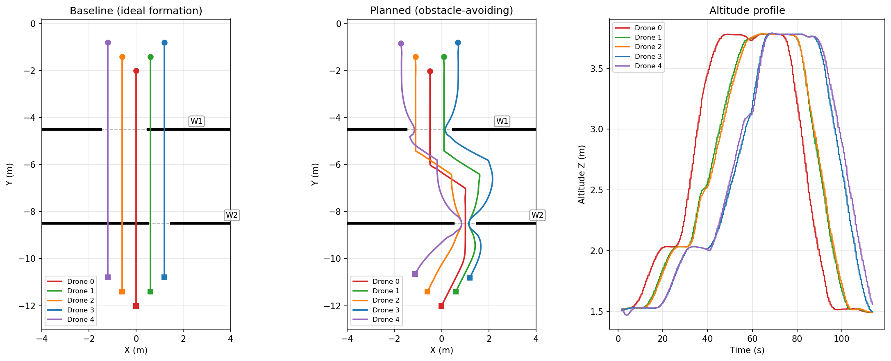
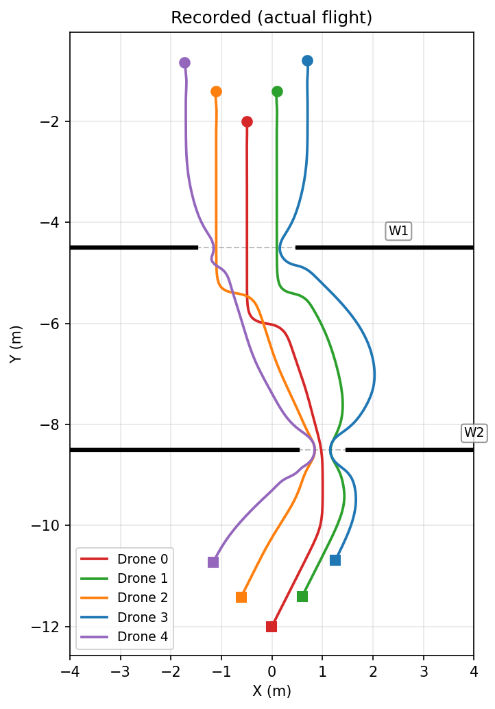
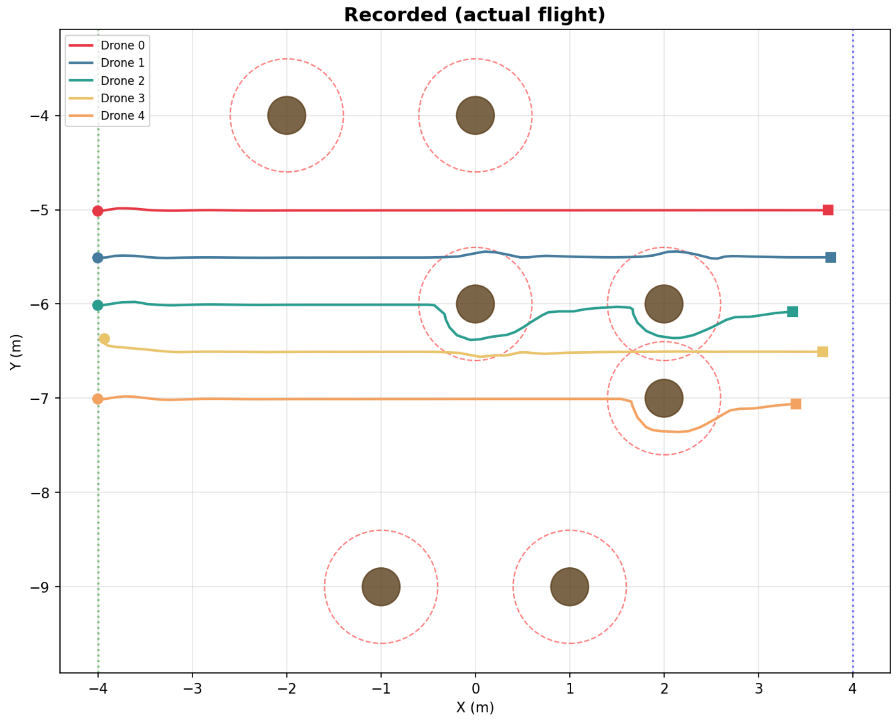
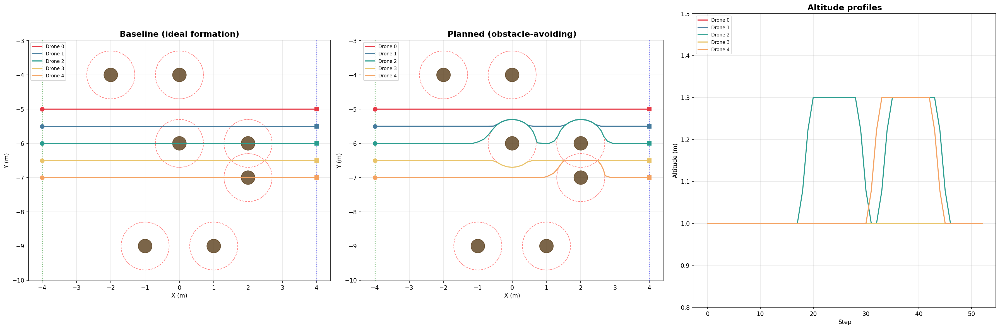
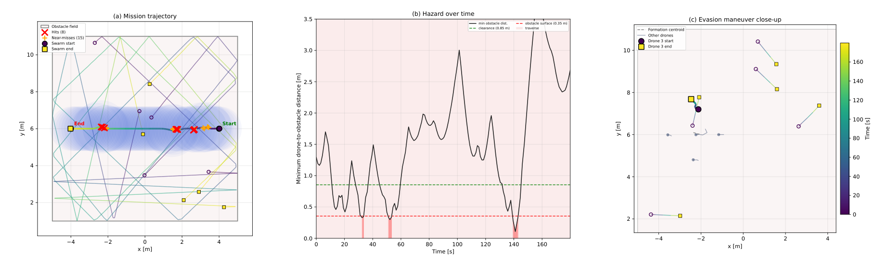

# Multi-UAV Formation Flight

This repository contains the code to fly a **swarm of five drones in formation** through four increasingly difficult environments in **Aerostack2** (ROS 2 Humble, Gazebo), with two coordination strategies compared on each:

* a **centralised** planner that holds the whole world model and computes collision-free, speed-synchronised trajectories for every drone before they move;
* a **decentralised** controller in which each drone steers itself from local information, using artificial potential fields.

The four stages are formation changes on a circular orbit, a narrow two-window passage, a static forest of pillars and a field of moving obstacles.

The full write-up is in [report.pdf](./report.pdf). Developed for Coursework 2 of the UCL module *COMP0240: Aerial Robotics: Fundamentals to Practice in Real-World Environments* (2026).



## Repository structure

| Stage | Centralised | Decentralised |
|---|---|---|
| 1 — formation changes on an orbit | `stage_1_central.py` | `stage_1_decentralised.py` |
| 2 — two narrow windows | `stage_2_mission.py --method centralised` | `stage_2_mission.py --method decentralised` |
| 3 — static forest | `stage_3_central.py` | `stage_3_decentralised.py` |
| 4 — moving obstacles | `stage_4_centralised.py` | `stage_4_decentralised.py` |

* [figures](./figures/) — the result figures;
* [report.pdf](./report.pdf) — the coursework report.

## Built on

The scripts run inside the course template [challenge_multi_drone](https://github.com/UCL-MSC-RAI-COMP0240/challenge_multi_drone) (BSD-3, Aerostack2 developers and UCL), which provides the simulator launch files, the swarm world and the four stage scenarios.

* [Aerostack2](https://github.com/aerostack2/aerostack2) — the drone framework, its Python API and the `go_to` and `follow_path` behaviours;
* [NumPy](https://numpy.org/) — the planners and the force computations.

## Method

**Formations.** Seven shapes (line, V, square, diamond, orbit, grid and staggered) are lists of 2D offsets from a formation centroid. A change of shape interpolates each drone's offset from the old shape to the new one.

**Centralised planner.** One ROS 2 node plans for all five drones and sends each its waypoints through the Aerostack2 Python API.

* Every waypoint inside an obstacle's clearance zone is pushed out to the edge of that zone, over several passes at about 0.05 m resolution.
* When two drones' paths come too close, the one further from its formation slot is lifted by a fixed height rather than pushed sideways.
* Each drone's speed is scaled to its own path length so that all five finish each section of the route together, within 0.2–1.5 m/s.
* For the moving obstacles of stage 4, each obstacle's path is predicted from its start position and speed, with straight-line motion and elastic bounces off the walls. The push-out step then checks every waypoint against where each obstacle will be when the drone arrives.

**Decentralised controller.** Each drone runs the same control law at 10 Hz and knows only its own position, its neighbours' positions and the obstacle map. A coordinator moves the formation centroid at constant speed and plans nothing. The command for each drone sums four forces:

* attraction to its formation slot;
* repulsion from obstacles, blended between radial and tangential so that drones slide around obstacles instead of stalling in front of them;
* repulsion from other drones inside a safety radius;
* a feed-forward push in the direction of travel.

For the moving obstacles of stage 4, the controller adds three things:

* it reads obstacle positions from the Gazebo physics engine instead of the provided topic, which published stale positions;
* it evaluates repulsion at both the current and the predicted obstacle position, scaled up for obstacles approaching head-on;
* it weakens the pull towards the formation slot while a drone is evading, so the drone can leave the formation and rejoin afterwards.

**Stage 2, gradient-descent MPC.** The potential-field controller cannot get the V-formation, 2.4 m wide, through the second window, a gap of 1.0 m: at the edge of the gap the attraction and the wall repulsion balance and the outer drones stall. Stage 2 therefore optimises each drone's whole path instead. The cost weighs wall clearance, distance from the drone's V slot and path curvature (weights 120, 1.5 and 3.0), and gradient descent runs for 400 iterations.

* Each V slot near a wall is pulled into the gap so that the formation term points at a reachable position, and the formation narrows without any explicit squeeze schedule.
* The centralised version optimises all five paths jointly and splits the route at the two windows into three segments. The decentralised version runs the same optimisation separately on each drone, and the five paths agree because every drone reads the same scenario and formation definition.
* Laplacian smoothing with a wall push-out and a pass that stops any backtracking finish each path.

## Results

| Mission time | Stage 1 | Stage 2 | Stage 3 | Stage 4 |
|---|---|---|---|---|
| Centralised | 131.0 s | 125.8 s | 84.2 s | 120.0 s |
| Decentralised | 146.6 s | 117.7 s | 126.2 s | 181.1 s |

* **Stages 1 and 3**: both approaches completed every formation change and the forest without a collision. The centralised planner was faster and kept the formation tighter, since its speed scaling keeps drones together after detours. In the decentralised version, drones that detoured trailed the formation by up to 0.5 m at the end of the forest.
* **Stage 2**: both versions took all five drones through both windows with no collision, a minimum wall clearance of 0.341 m (centralised) and 0.350 m (decentralised) against the required 0.35 m, and 0.302 m minimum spacing between drones. Planning took 2.95 s jointly and 1.96 s in total for the five separate solves. The decentralised version finished first because the centralised one hands over between three path segments.
* **Stage 4**: the decentralised controller kept the formation through the moving obstacles, but a purely reactive controller has a hard limit here. At a closing speed of 3 m/s an obstacle crosses the clearance ring in about 0.17 s, less than two control cycles. The closest approach was 0.106 m, and 8 of the 162 logged cycles were below the 0.35 m obstacle surface. The centralised planner is built to get around this limit, by planning around where the obstacles will be rather than reacting to where they are.

| | |
|---|---|
|  |  |





The main lessons: the centralised planner was faster in three of the four stages and needed far less tuning, since its parameters carried over between stages, while the potential-field gains needed separate tuning for each stage. Reactive potential fields fail in narrow passages, where attraction and repulsion cancel, and against fast-moving obstacles, where there is too little time to react. A hybrid that plans centrally and leaves fine reactive avoidance to each drone is the natural next step.

## Running

Set up the ROS 2 workspace and the template as described in the [template README](https://github.com/UCL-MSC-RAI-COMP0240/challenge_multi_drone), then copy the scripts of this repository into the template folder. For stage 3, for example, one terminal each:

```
./launch_as2.bash -s scenarios/scenario1_stage3.yaml -w config_sim/config/world_swarm.yaml
./launch_ground_station.bash -n drone0,drone1,drone2,drone3,drone4 -s scenarios/scenario1_stage3.yaml
python3 stage_3_central.py -n drone0 drone1 drone2 drone3 drone4 -c scenarios/scenario1_stage3.yaml
```

Replace the stage number in the scenario and script names for the other stages. Stage 2 takes `--method centralised` or `--method decentralised` and writes the flown trajectories to `traj_stage2_<method>.csv`.

## Author

Amir Gerges, MSc Robotics and Artificial Intelligence, UCL.
